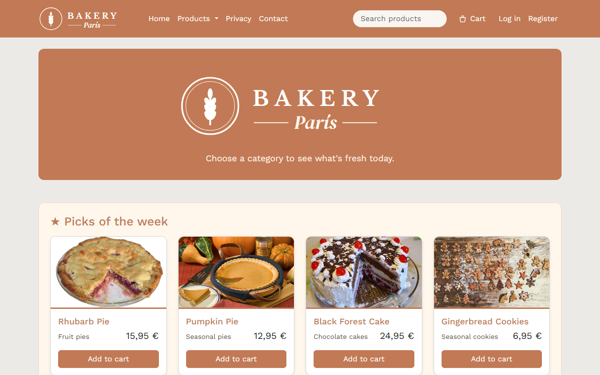
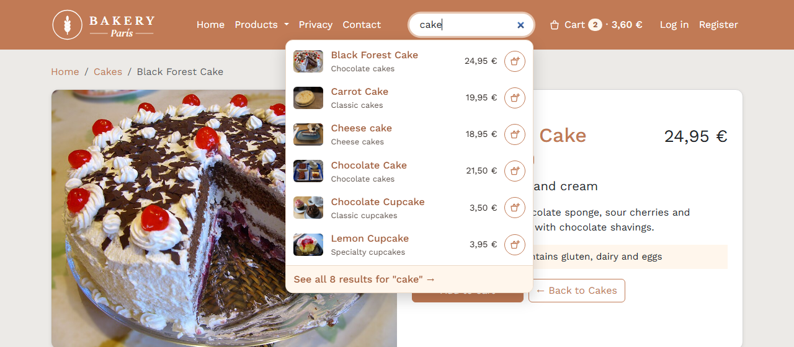
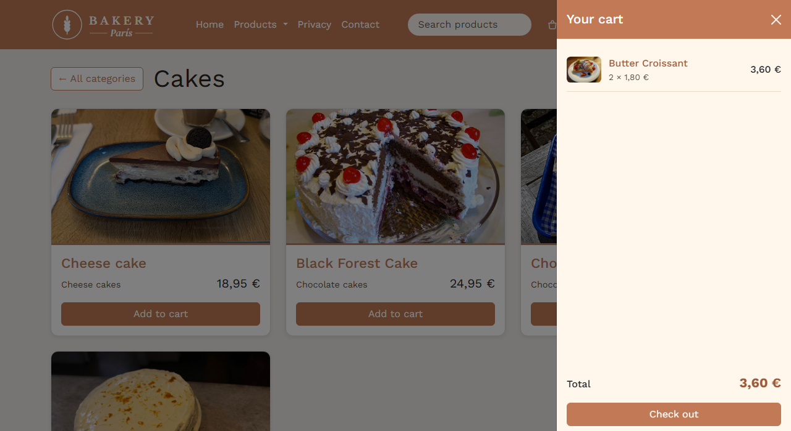
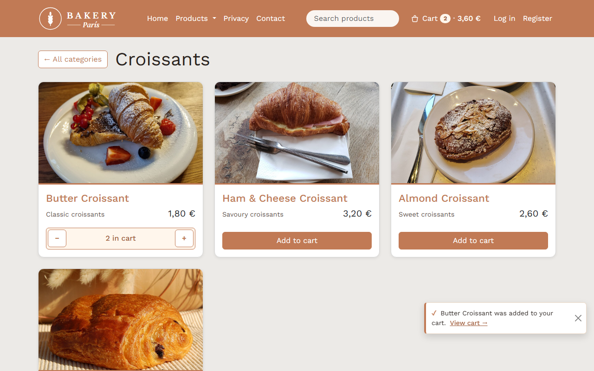
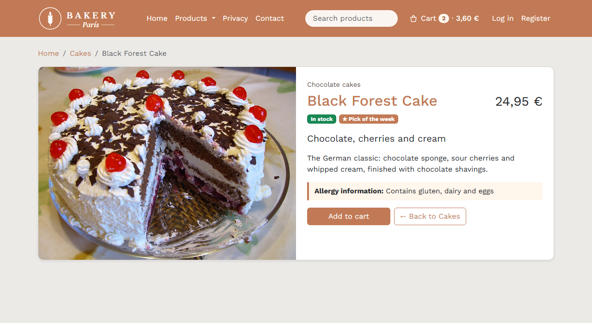

# Bakery París

[](https://github.com/parisoiko/eShopEnhanced/actions/workflows/ci.yml)


A complete online bakery shop built with **ASP.NET Core 10 MVC**, **Entity Framework Core**, **ASP.NET Core Identity** and **Blazor Server**: browse categories, search as you type, add to the cart without page reloads, register, and check out.

The project started from a Pluralsight ASP.NET Core fundamentals course (the classic "pie shop" example) and was then redesigned and extended well beyond it. See [What I built beyond the course](#what-i-built-beyond-the-course).



## Features

- **Catalog**: two-level categories (Pies › Fruit pies › Strawberry Pie), 6 categories with 24 products, picks of the week, product details
- **Clean URLs**: `/products/cupcakes`, `/products/7/black-forest-cake` (wrong or missing slugs 301-redirect to the canonical URL)
- **Live search**: a navbar search box with a dropdown of matches as you type, plus a full search page written as a **Blazor Server** component
- **Shopping cart**: session-based cart stored in the database, **add/remove without page reloads**, `− 2 +` counters on every product, item count and total in the navbar, and a slide-out mini cart
- **Checkout**: form tag helpers, model binding and validation on both client and server, Post/Redirect/Get, order lines that keep the price at the time of ordering
- **Accounts**: ASP.NET Core Identity with a custom registration page (name and delivery address), a checkout that is pre-filled from the account, and an initials avatar in the navbar
- **Design**: custom "Bakery París" brand (logo as inline SVG, palette, favicon), responsive Bootstrap 5 layout, Greek (`el-GR`) price formatting (`15,95 €`)

| Live search with quick add | Slide-out cart |
|---|---|
|  |  |

| Category page with cart counter | Product details |
|---|---|
|  |  |

## Tech stack

| Area | Technology |
|---|---|
| Web | ASP.NET Core 10 MVC, Razor views, partial views, view components, custom tag helper, Razor Pages (Identity) |
| Interactivity | Blazor Server component, vanilla JavaScript (`fetch` + JSON endpoints), Bootstrap 5 |
| Data | Entity Framework Core 10, SQL Server (LocalDB), 9 migrations, seed data |
| Auth | ASP.NET Core Identity, custom user (`ApplicationUser`), custom claims |
| Tests | xUnit, Moq, `WebApplicationFactory` integration tests on in-memory SQLite (53 tests) |
| CI | GitHub Actions: build and test on every push |

## What I built beyond the course

The course covers the basics (MVC, EF Core, a cart, a checkout form, Identity, a Blazor search). On top of that I:

- **Re-modelled the domain**: `Pie` became a generic `Product`, with a two-level `Category › SubCategory` hierarchy, and a hand-written migration that **renames** tables and columns instead of the drop-and-recreate EF scaffolded, so no data is lost.
- **Reorganised the code** into `Data/`, `Repositories/`, `Services/`, `ViewModels/`, `ViewComponents/`, `TagHelpers/`.
- **Made data access async and lean**: every repository method is async and returns materialised lists, uses `AsNoTracking()` for reads, and each page runs a predictable, small number of SQL queries (verified with EF Core logging).
- **Replaced conventional routes** with attribute routing, slugs, route constraints (`{id:int}`) and canonical 301 redirects.
- **Built a no-reload cart**: the add and remove endpoints answer JSON to `fetch` requests and redirect normal form posts, so the site still works without JavaScript.
- **Added the navbar search** with a debounced dropdown, request cancellation and quick-add buttons. A server-rendered fragment keeps it light, and the Blazor page shows the full results.
- **Extended Identity**: a custom registration page, profile fields, a pre-filled checkout, and the user's name stored in the cookie claims so the avatar needs no database query on each page.
- **Hardened the forms**: anti-forgery tokens on every state-changing POST, `[BindNever]` against over-posting, `Url.IsLocalUrl` against open redirects, and explicit `[Required]` because the implicit "non-nullable means required" rule is skipped when a field is missing from the request.
- **Added tests and CI**: unit tests for controllers, validation, the slug helper and the tag helper, and integration tests that start the real app in memory.

## Design decisions worth a look

A few problems I ran into and how I solved them:

- **Untracked entities and foreign keys**: products are read with `AsNoTracking()`, so cart and order lines set `ProductId` rather than the `Product` navigation. Otherwise EF Core would try to insert the product again (`Services/ShoppingCart.cs`, `Repositories/OrderRepository.cs`).
- **Blazor Server and `DbContext`**: a Blazor component lives as long as the browser tab, and fast typing starts overlapping searches. Each search gets its own DI scope and `DbContext`, and a counter discards out-of-order results (`Components/ProductSearch.razor`).
- **Blazor under a sub-path**: the search page lives at `/products/search`, so it sets `<base href="/">`. Without it, Blazor would look for its hub at `/products/_blazor`.
- **Nested forms**: the search dropdown contains add-to-cart forms, so it sits next to the search `<form>` and not inside it. HTML silently drops nested forms.
- **Customising library UI**: the Identity pages get the shop layout from a file placed at the exact path of the package's own layout (`Areas/Identity/Pages/_Layout.cshtml`).

More of my learning notes are in [docs/NOTES.md](docs/NOTES.md).

## Project structure

```
eShopEnhanced/                 ASP.NET Core web project
├── Areas/Identity/Pages/      custom Register page + Identity layout override
├── Components/                Blazor Server search component
├── Controllers/               Home, Product, ShoppingCart, Order
├── Data/                      DbContext + seed data (auto-migrates on start-up)
├── Helpers/                   URL slugs
├── Migrations/                EF Core migrations
├── Models/                    Product, Category, SubCategory, Order, ApplicationUser, ...
├── Repositories/              data access (async, read-only queries use AsNoTracking)
├── Services/                  session-based ShoppingCart, Identity claims factory
├── TagHelpers/                <email> tag helper
├── ViewComponents/            category menu, cart summary
├── ViewModels/
├── Views/                     Razor views and partials
└── wwwroot/                   CSS, JavaScript, images
eShopEnhanced.Tests/           xUnit unit and integration tests
docs/                          screenshots and learning notes
```

## Getting started

**Requirements:** [.NET 10 SDK](https://dotnet.microsoft.com/download) and SQL Server LocalDB (installed with Visual Studio, or on its own on Windows).

```bash
git clone https://github.com/parisoiko/eShopEnhanced.git
cd eShopEnhanced
dotnet run --project eShopEnhanced
```

On first start the app **creates the database, applies the migrations and seeds the products by itself**, so there is no `dotnet ef` step. Open the URL shown in the console and register an account to check out.

To use another SQL Server, change `ConnectionStrings:eShopEnhancedDbConnection` in `eShopEnhanced/appsettings.json` (or override it with an environment variable or user secrets).

## Tests

```bash
dotnet test
```

- **Unit tests**: `ProductController` and `OrderController` (with Moq), `Order` validation rules, the slug helper and the email tag helper.
- **Integration tests**: `WebApplicationFactory<Program>` starts the real app with an in-memory SQLite database and checks pages, 404s, slug redirects, search suggestions, the add-to-cart JSON endpoint, anti-forgery protection and the login requirement for checkout.

## Credits

- Built while following a Pluralsight ASP.NET Core fundamentals course, then extended as described above.
- Product photos come from Wikimedia Commons under their respective licenses. See [IMAGE-CREDITS.md](eShopEnhanced/IMAGE-CREDITS.md).
- Fonts: Work Sans, Libre Baskerville and DM Serif Display (Google Fonts, SIL Open Font License).

## License

The code is released under the [MIT License](LICENSE). The product photos keep their own licenses.
